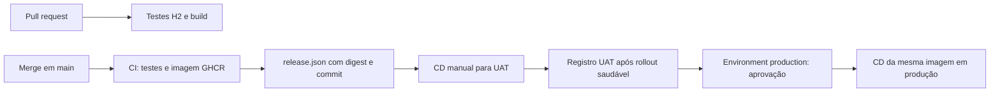

# Implantação independente: UAT e produção

## 1. Fluxo e responsabilidades



CI não acessa a nuvem. CD não compila Java nem publica imagens. O operador informa o ID da execução CI, e o deploy lê o digest do artefato `release`. Produção exige também o ID da execução CD UAT bem-sucedida; seu registro precisa ser idêntico ao da versão escolhida. O fluxo permite promover ou reinstalar uma versão sem novo build. Readiness inclui a saúde do banco H2; rollout saudável não substitui a homologação funcional humana.

A configuração de deploy é lida da revisão de `main` que iniciou o CD; a imagem vem do CI selecionado. Os manifests renderizados são arquivados por execução para auditoria. Revise mudanças de infraestrutura com o mesmo rigor do código. A aprovação humana de produção deve confirmar o resultado da homologação e a compatibilidade das migrações.

## 2. Publicar o repositório

Crie um repositório vazio no GitHub. Na pasta deste projeto:

```bash
git init -b main
git add .
git commit -m "feat: CRUD Maven com CI e deploy Kubernetes"
git remote add origin git@github.com:SUA_ORG/crud-maven.git
git push -u origin main
```

Configure ruleset para `main`: exigir pull request, revisão de outro mantenedor, check `build` do workflow CI e impedir force push. Restrinja quem pode editar workflows/infra por revisão de responsáveis (configure CODEOWNERS com usuários/equipes reais). As Actions estão fixadas por SHA; Dependabot propõe atualizações. Não use `pull_request_target` para executar código de PR.

## 3. Pré-requisitos da nuvem (administrador)

Provisione EKS, preferencialmente em contas/clusters separados para UAT e produção. Nesta etapa, o banco de teste H2 é embarcado em memória: não é necessário provisionar banco externo. Este repositório não contém Terraform nem cria esses recursos. Configure a rede do cluster. Use versão kubectl compatível com seu cluster; o workflow fixa 1.34.1 e precisa ser atualizado se a versão do servidor exigir.

O runner precisa alcançar a API Kubernetes. Para endpoint privado, substitua `runs-on: ubuntu-24.04` no deploy por um runner efêmero gerenciado na VPC. Nunca use esse runner privilegiado para PRs não confiáveis. O runner precisa de AWS CLI v2, `gh`, `jq` e acesso ao GitHub/GHCR; essas ferramentas já existem no runner hospedado usado como referência.

Em cada cluster, usando uma identidade administrativa e contexto confirmado:

```bash
kubectl config current-context
kubectl create namespace crud-uat
kubectl -n crud-uat apply -f infra/bootstrap/rbac.yaml
# No cluster de produção, repita com crud-production.
```

O H2 roda dentro da JVM, sem Secret de banco ou volume. Flyway cria o schema a cada nova instância e o Hibernate valida o mapeamento. Todos os ambientes têm uma réplica e estratégia `Recreate`: cada deploy/reinício descarta os dados e causa uma breve indisponibilidade. Não aumente réplicas com H2 em memória, pois cada pod teria dados independentes. O PDB permite a interrupção da única réplica para manutenção.

O ambiente `production` continua disponível para exercitar promoção/aprovação, mas usa dados de teste descartáveis por enquanto. Para dados duráveis e alta disponibilidade, será necessário substituir H2 por um banco persistente e rever réplicas, estratégia de atualização e PDB.

## 4. Registry GHCR

O CI publica `ghcr.io/organizacao/repositorio:sha-COMMIT` e grava a referência `@sha256:...`. A autorização de publicação usa apenas `GITHUB_TOKEN` com `packages: write`.

**O manifesto padrão pressupõe imagem acessível sem credenciais de pull.** Para uma demonstração pública, depois da primeira publicação configure a visibilidade do pacote como pública nas configurações do GHCR. Isso torna a imagem pública; mantenha pacote privado se houver código confidencial.

Para pacote privado, crie um Secret `kubernetes.io/dockerconfigjson` em cada namespace com uma credencial de leitura de pacotes administrada e rotacionada pela organização. Adicione `imagePullSecrets: [{name: ghcr-pull}]` em `spec.template.spec` por patch nos overlays antes do primeiro deploy. Não use o `GITHUB_TOKEN` efêmero como credencial permanente de pull. A política corporativa pode substituir GHCR por ECR e usar a identidade dos nós para pull.

## 5. GitHub Environments e OIDC AWS

Crie os Environments **exatamente** `uat` e `production` em Settings → Environments. Em ambos, limite deployment a `main`. Em `production`, configure required reviewers e prevenção de autoaprovação; confirme a disponibilidade dessas proteções no plano/visibilidade do repositório. Essa aprovação é configuração do GitHub, não uma propriedade do YAML. Não considere o fluxo protegido até confirmar que o job fica aguardando o revisor.

Defina estas **Variables** em cada Environment (não são chaves secretas):

| Variável | Exemplo |
|---|---|
| `AWS_REGION` | `sa-east-1` |
| `AWS_ROLE_ARN` | `arn:aws:iam::123456789012:role/github-crud-uat` |
| `EKS_CLUSTER_NAME` | `eks-uat` |

Na AWS, registre o provedor OIDC `https://token.actions.githubusercontent.com` com audience `sts.amazonaws.com`. Crie uma role por ambiente, com trust policy como a abaixo, substituindo conta/organização/repositório. Para produção troque o subject para `environment:production`.

```json
{
  "Version": "2012-10-17",
  "Statement": [{
    "Effect": "Allow",
    "Principal": {"Federated": "arn:aws:iam::123456789012:oidc-provider/token.actions.githubusercontent.com"},
    "Action": "sts:AssumeRoleWithWebIdentity",
    "Condition": {
      "StringEquals": {
        "token.actions.githubusercontent.com:aud": "sts.amazonaws.com",
        "token.actions.githubusercontent.com:sub": "repo:SUA_ORG/crud-maven:environment:uat"
      }
    }
  }]
}
```

Anexe à role uma policy IAM restrita ao cluster correspondente:

```json
{
  "Version": "2012-10-17",
  "Statement": [{
    "Effect": "Allow",
    "Action": "eks:DescribeCluster",
    "Resource": "arn:aws:eks:sa-east-1:123456789012:cluster/eks-uat"
  }]
}
```

Habilite EKS Access Entries (modo de autenticação `API` ou `API_AND_CONFIG_MAP`) e mapeie a role para o grupo Kubernetes `crud-deployers`, que tem RoleBinding apenas no namespace correspondente:

```bash
aws eks create-access-entry --cluster-name eks-uat \
  --principal-arn arn:aws:iam::123456789012:role/github-crud-uat \
  --type STANDARD --kubernetes-groups crud-deployers --region sa-east-1
```

Repita no cluster de produção com a role de produção. **Se compartilhar um cluster**, use grupos diferentes por ambiente e ajuste os respectivos RoleBindings; o mesmo grupo nos dois namespaces daria acesso a ambos. Não associe uma policy EKS de cluster-admin ao pipeline. O RBAC fornecido permite aplicar os recursos da aplicação e consultar rollout, sem acesso a Secrets, namespaces ou administração do cluster.

## 6. Executar e promover

1. Abra PR. CI executa `./mvnw verify` com H2 em memória, renderiza os três overlays e constrói o contêiner sem publicá-lo.
2. Faça merge em `main`. CI repete a validação, publica a imagem e arquiva `release.json` com digest, commit e ID do CI.
3. Em Actions → CD → Run workflow, selecione `main`, `environment=uat` e `build_run_id=ID_DO_CI`. Deixe `uat_run_id` vazio.
4. CD autentica por OIDC, renderiza o overlay, faz dry-run no servidor, aplica os manifests e aguarda readiness. Ao terminar, arquiva `uat-release` como comprovante daquela imagem.
5. Execute a homologação funcional. Para acesso privado de teste, um operador autorizado pode usar `kubectl -n crud-uat port-forward service/crud 8080:80`.
6. Inicie outro CD em `main`, agora com `environment=production`, o **mesmo** `build_run_id` e `uat_run_id=ID_DO_CD_UAT`. O revisor aprova no GitHub Environment. O pipeline confere a origem do CI e o comprovante UAT antes de aplicar a mesma imagem.

Também é possível iniciar via GitHub CLI:

```bash
gh workflow run cd.yaml --ref main -f environment=uat -f build_run_id=123456
gh workflow run cd.yaml --ref main -f environment=production \
  -f build_run_id=123456 -f uat_run_id=789012
```

Não execute duas publicações concorrentes do mesmo ambiente: o workflow serializa deploys e não cancela um rollout em andamento. O GitHub pode substituir execuções pendentes na fila; confira quais execuções realmente iniciaram. Ações manuais podem reinstalar versões anteriores intencionalmente; não existe política de versão monotônica.

## 7. Falha e rollback

O job falha se o dry-run ou o rollout falhar. Em falhas, lista pods e eventos; consulte o histórico de Actions e os artefatos renderizados. Não há rollback automático: uma migração incompatível não é revertida ao trocar a imagem.

Rollback rastreável: execute CD apontando para um CI anterior cujo contrato de banco ainda seja compatível; para produção informe seu CD UAT aprovado. Os artefatos são retidos por 90 dias, sujeitos ao limite da organização. Preserve releases por prazo maior em armazenamento de auditoria se precisar de rollback além dessa janela.

Emergência, apenas por operador com autorização:

```bash
kubectl -n crud-production rollout history deployment/crud
kubectl -n crud-production rollout undo deployment/crud
kubectl -n crud-production rollout status deployment/crud --timeout=300s
```

Com H2, qualquer reinício já perde os dados; o rollback do Deployment não restaura dados nem reverte outros manifests. Depois, registre a intervenção e execute um CD que restabeleça uma revisão conhecida. Use migrações expand/contract, teste restauração do banco e planeje mudanças destrutivas separadamente.

## 8. Operação e extensão

O exemplo inclui execução sem root, filesystem somente leitura, probes, limites de CPU/memória, encerramento gracioso e PodDisruptionBudget compatível com uma réplica descartável. Antes de abrir acesso externo, acrescente identidade de usuários, TLS/Ingress, política de rede adequada ao CNI, métricas, alertas, gestão de segredos e verificação de vulnerabilidades com política de bloqueio. Provenance e SBOM são gerados no build; não há verificação de assinatura/admissão implementada. Ajuste recursos com testes de carga; só aumente réplicas após adotar um banco compartilhado persistente.

Para centralizar workflows em outro repositório, mova o reutilizável e chame `SUA_ORG/pipelines/.github/workflows/deploy.yaml@SHA_COMPLETO`. Mantenha inputs explícitos, permissões mínimas e Environments no repositório chamador. Ajuste a política OIDC caso a organização personalize os claims. Nesta entrega o reutilizável está no mesmo repositório e pode ser executado pelo CD sem executar CI novamente.

Para AKS/GKE, substitua somente a autenticação e obtenção do contexto no reutilizável pela identidade federada do provedor; valide também registry, rede e versão do kubectl. Os manifests da aplicação permanecem Kubernetes padrão.

## Referências oficiais

- [GitHub Environments e proteções](https://docs.github.com/en/actions/concepts/workflows-and-actions/deployment-environments)
- [GitHub OIDC com AWS](https://docs.github.com/en/actions/how-tos/secure-your-work/security-harden-deployments/oidc-in-aws)
- [OIDC em workflows reutilizáveis](https://docs.github.com/en/actions/how-tos/secure-your-work/security-harden-deployments/oidc-with-reusable-workflows)
- [EKS Access Entries](https://docs.aws.amazon.com/eks/latest/userguide/access-entries.html)
- [Kustomize no Kubernetes](https://kubernetes.io/docs/tasks/manage-kubernetes-objects/kustomization/)
- [Requisitos Spring Boot 3.5](https://docs.spring.io/spring-boot/3.5/system-requirements.html)
